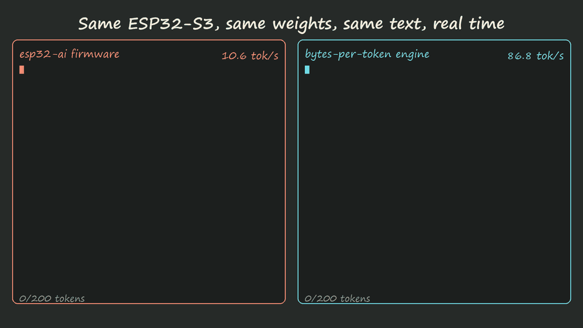

# bytes-per-token

**A language model on an $8 ESP32-S3 at ~87 tokens/s: 8x faster than the reference port, on the same board and the same weights.**

**[Try it in your browser](https://alikup-ai.github.io/bytes-per-token/)**: flash an ESP32-S3-N16R8 over USB from Chrome or Edge, then watch it write. No toolchain needed.



<sub>Both panels replay the same 200 tokens at the speed measured on the board for each firmware
(94.1 vs 11.5 ms/token, ESP32-S3-N16R8, PSRAM 80 MHz). The text is the actual output; our engine reproduces it
character for character. Made by <code>docs/media/race_gif.py</code>.</sub>

On a microcontroller, once the multiply is vectorized, generation speed is set by one number:
how many bytes of weights you read from PSRAM per generated token. This repo measures that on real
hardware, builds a cost model around it, and cuts the bytes until the chip runs out of tricks.

## Results (ESP32-S3-N16R8, 240 MHz, PSRAM 80 MHz)

Same model ([slvDev/esp32-ai](https://github.com/slvDev/esp32-ai), 28.9M params, TinyStories), same int4
weights, same prompt, positions 4-203. Their firmware was rebuilt and re-measured on this board.

| engine | output layer | ms/token | tok/s | speedup |
|---|---|---:|---:|---:|
| esp32-ai firmware (int8-staged, scalar C) | full | 94.10 | 10.6 | 1.0x |
| this engine (int4, PIE SIMD, 2 cores) | full | 25.00 | 40.0 | **3.8x** |
| this engine | two-stage, 15% of rows | 11.52 | 86.8 | **8.2x** |

- Same text: the two-stage engine generated the same 200 tokens as their firmware, 759/759 characters.
  Two-stage top-1 agrees with the full output layer 99.8% of the time.
- **Our own 8.6M model**, designed for bytes per token: **0.63 bits/byte** on TinyStories validation
  vs 0.86 for the 28.9M esp32-ai model, at ~80-95 tok/s on the board.
- Every run is checked **bit for bit**: board == PC reference == scalar C, plus engine NLL vs PyTorch.

## Why bytes per token

Measured on the board (`bench/`):

| what | value |
|---|---|
| int4 x int8 dot product on PIE, weights in SRAM | **0.47 cycles/MAC** (~13x esp32-ai's int8 C kernel) |
| PSRAM read bandwidth, 1 / 2 cores | 73 / 83 MB/s (~90 MB/s bus total, incl. GDMA) |

One core multiplies ~510M int4 weights/s; PSRAM delivers ~166M. The chip waits on memory, so:

```
bytes/token = N_weights x bits/weight x fraction_read / (8 x tokens_per_weight_pass)
```

Levers used, each measured on the board:

| lever | how | effect |
|---|---|---|
| bits/weight | 4-bit QAT, PIE int4 kernel | half the bytes of int8 |
| fraction read, output layer | k-means over head rows, read top clusters only (15% of rows) | head 17.3 -> 4.2 ms |
| fraction read, FFN | ReLU instead of SwiGLU, skip dead neurons (79% dead, ~52% of FFN bytes saved) | free in quality |
| where bytes live | always-read weights in SRAM, per-layer embeddings (PLE) in flash | fewer PSRAM bytes |
| bandwidth | both cores stream PSRAM | x1.26-1.30, matches 73 -> 83 MB/s |
| tried, did not pay | DMA prefetch (shared bus), speculative decoding (compute per token) | explained by the cost model |

The cost model (`costmodel/`) predicts ms/token within 12-14% of the board.

## Prior work this builds on

None of the individual techniques is new; the contribution is putting them together on a
PSRAM-backed MCU, measuring each one in bytes, and the cost model.

- [esp32-ai](https://github.com/slvDev/esp32-ai) - the baseline model and the idea of PLE in flash on ESP32-S3.
- Per-Layer Embeddings: [Gemma 3n](https://ai.google.dev/gemma/docs/3n).
- ReLU activation sparsity: [ReLU Strikes Back](https://arxiv.org/abs/2310.04564), [Deja Vu](https://arxiv.org/abs/2310.17157), [LLM in a flash](https://arxiv.org/abs/2312.11514).
- Candidate screening for the output layer: [Learning to Screen](https://arxiv.org/abs/1810.12406).
- Other ESP32-S3 ports: [DaveBben/esp32-llm](https://github.com/DaveBben/esp32-llm), [doryiii/esp32-llm](https://github.com/doryiii/esp32-llm).

## Repo layout

| folder | contents |
|---|---|
| `bench/` | board microbenchmarks (memory, PIE, DMA, PSRAM bus) and logs |
| `costmodel/` | per-op cost model, calibration, what-if scenarios |
| `train/` | PyTorch models, QAT training, sweeps, bits/byte comparison |
| `engine/` | C engine shared by PC and board, ESP-IDF firmware, exporters, tests, browser demo |
| `decode/` | speculative decoding simulation |
| `docs/` | experiment log per phase (`phase*.md`), full report (`report.html`) |

## Run it

Hardware: ESP32-S3-N16R8 (16 MB flash, 8 MB octal PSRAM). ESP-IDF 5.5.

```sh
python -m venv .venv && .venv/Scripts/pip install torch tokenizers numpy scipy pyserial esptool
python engine/export_esp32ai.py                     # download esp32-ai weights (SHA-256 checked), pack them
python engine/test.py esp32ai_ts                    # PC: engine vs PyTorch
python engine/test.py esp32ai_ts --port COM6 --flash-app   # board: build, flash, check bit-exact, time it
```

Browser demo (Chrome/Edge over Web Serial): [alikup-ai.github.io/bytes-per-token](https://alikup-ai.github.io/bytes-per-token/), source in [`web/`](web/).
The flashable images are built by `idf.py -B builddemo -D SDKCONFIG=sdkconfig.demo -DLLM_DEMO=1 build` in `engine/esp32` and `esptool merge_bin` with the model pack at 0x90000.
Training from scratch: `train/data.py`, then `train/sweep_*.sh` (~30-50 min per model on CPU).

## Limitations

- Small models trained on children's stories (TinyStories), 256-token context.
- Speed depends on context position (KV cache is in PSRAM): ~110 tok/s early, ~72 tok/s at the end of the context.
- PSRAM at 120 MHz is an experimental ESP-IDF mode and is not used in the headline numbers.
- Second core busy-waits and the task watchdog is off; energy per token not measured yet.

Russian notes: [README.ru.md](README.ru.md). License: MIT.
